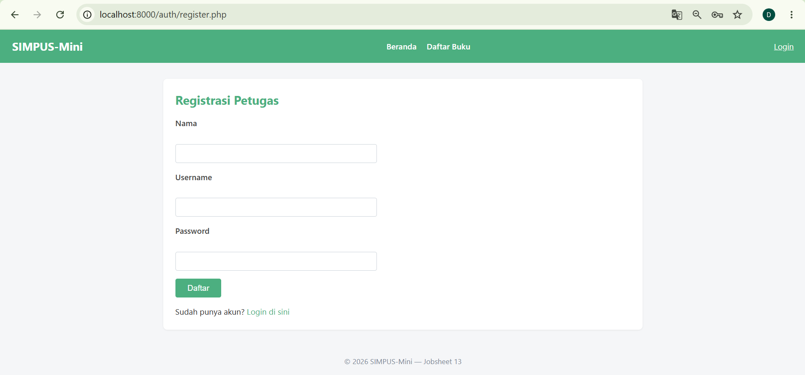
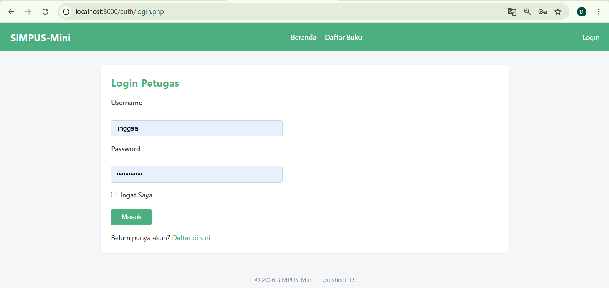
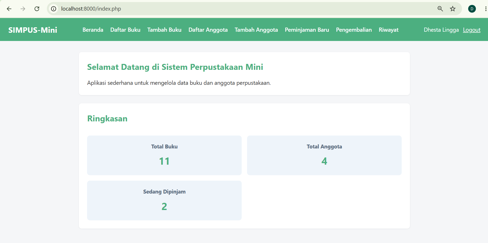
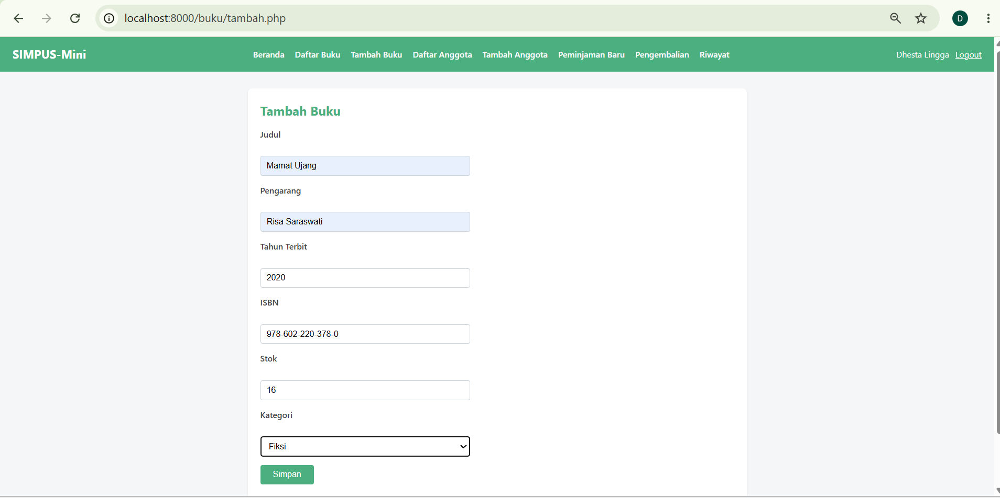
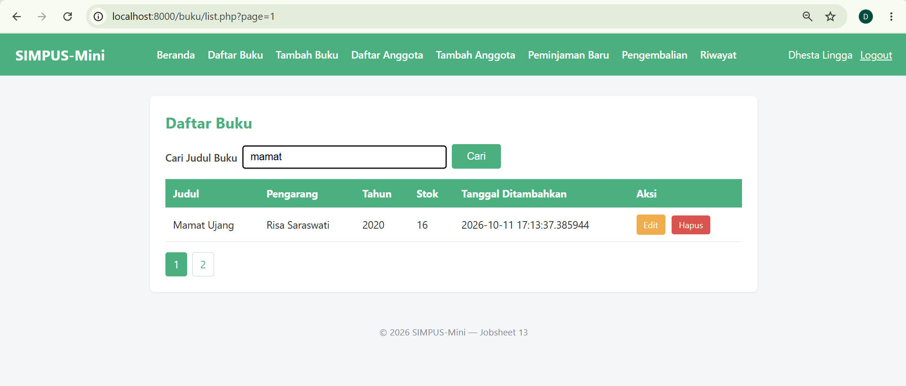
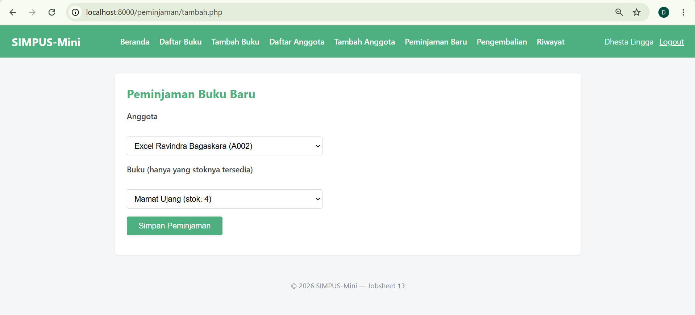
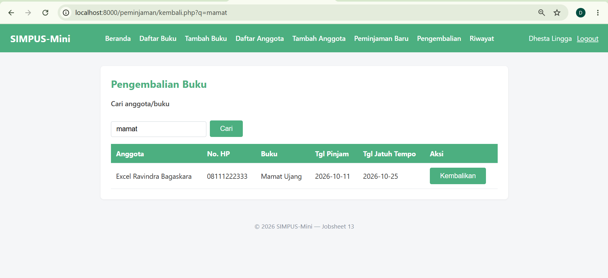
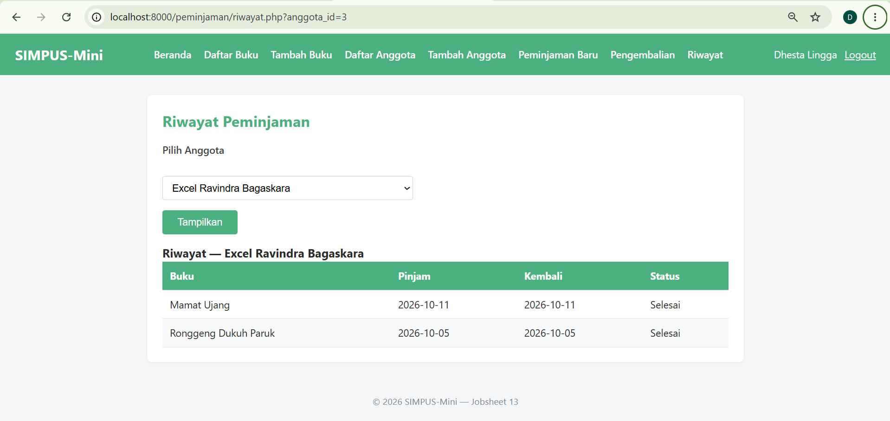

Manual Pengguna — SIMPUS-Mini

1. Registrasi & Login Petugas
Buka http://localhost:8000/auth/register.php.
Isi Nama, Username, Password (minimal 6 karakter), klik Daftar. 
Setelah berhasil, akan diarahkan ke halaman Login. Masukkan username & password yang baru dibuat, klik Masuk. 
Setelah berhasil login, navbar menampilkan nama petugas dan tombol Logout, serta menu tambahan (Tambah Buku, Daftar/Tambah Anggota, Peminjaman) yang tidak terlihat oleh Tamu. 

2. Mengelola Data Buku
Klik menu Tambah Buku, isi Judul, Pengarang, Tahun, ISBN, Stok, Kategori, klik Simpan. 
Buku baru langsung tampil di Daftar Buku. Gunakan kolom pencarian untuk menyaring berdasarkan judul. 
Klik Edit pada baris buku untuk mengubah data, atau Hapus untuk menghapus (akan muncul konfirmasi sebelum data benar-benar dihapus).

3. Mengelola Data Anggota
Alurnya sama dengan Buku: menu Tambah Anggota → isi form → tampil di Daftar Anggota → Edit/Hapus tersedia per baris.

4. Meminjamkan Buku
Klik menu Peminjaman Baru.
Pilih Anggota dan Buku (hanya buku dengan stok tersedia yang muncul di pilihan), klik Simpan Peminjaman. 
Kembali ke Beranda — kartu "Sedang Dipinjam" bertambah, dan stok buku terkait di Daftar Buku berkurang 1.

5. Mengembalikan Buku
Klik menu Pengembalian.
Cari transaksi berdasarkan nama anggota atau judul buku (opsional), lalu klik Kembalikan pada baris yang sesuai. 
Stok buku terkait bertambah kembali 1, dan transaksi hilang dari daftar peminjaman aktif.

6. Melihat Riwayat Peminjaman
Klik menu Riwayat.
Pilih nama anggota dari dropdown, klik Tampilkan.
Tabel menampilkan seluruh riwayat peminjaman anggota tersebut beserta status (Dipinjam/Selesai). 

7. Logout
Klik Logout di navbar kanan atas untuk mengakhiri sesi. Setelah logout, menu-menu yang membutuhkan login (Tambah Buku, Anggota, Peminjaman) akan hilang dari navbar dan halamannya tidak bisa diakses langsung (otomatis diarahkan ke halaman Login).